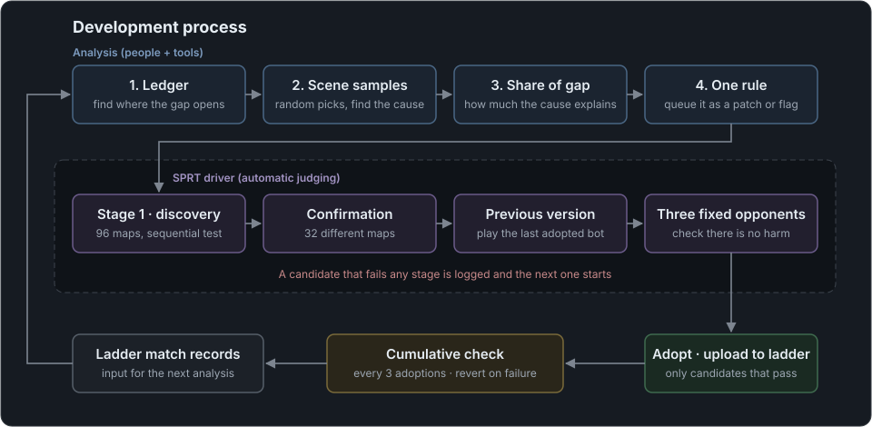

# Cambridge Battlecode 2026 Autumn — Final Bot and SPRT Driver

[한국어](README.md) | English

This is team SkuBap's final adopted version (v668), together with the tool that judged and adopted candidate rules automatically.
Peak ladder rank: 17 (Master).

## About the contest

[Cambridge Battlecode](https://battlecode.co.uk) is a competition run at the University of Cambridge. Each team writes a bot that plays the game, uploads it, and the bots play each other automatically on a ladder ranked by Elo. Nobody controls a bot during a match.

The 2026 autumn game is a two-team strategy game.

- **Draft**: at the start of a match the two teams take turns picking champions (3 to 5, depending on the map). Each champion has its own stats and abilities.
- **Farming**: neutral monster camps sit on the map in groups. Killing and capturing a group gives gold and gems.
- **Growth**: gold buys items in the shop, which make champions stronger.
- **Winning**: gems handed in at the altar become the team's score. The first team to hand in 1,000 gems wins; otherwise the team with more gems after 2,000 rounds wins.
- **Fighting**: killing an enemy champion earns gold. The champion that dies loses the gems it was carrying and is out of play for a while. The choice between farming and fighting decides matches.
- **Fuel**: a bot has a fixed compute budget (fuel) each turn. Going over it costs the turn, so computing a good decision cheaply is part of the skill.

### Timeline

| When | What |
|---|---|
| 12 October | Game released |
| 18 and 25 October, 1 November | Sprints 1, 2 and 3 (mid-season tournaments) |
| 4 November | International qualifier (top 8 teams advance) |
| 16–18 November | Finals in Cambridge |

During the contest, teams may not use other teams' code and must keep their own code private until the contest ends. This repository was made public after the contest finished.

### Our result

- Team SkuBap, bot written in C++.
- 668 versions uploaded to the ladder in one month.
- Peak ladder rank 17; last recorded rank 19 (2,450 Elo, Master tier).

## Development process

We looked in ladder records for where the gap opened, confirmed the cause, wrote one rule, and let the driver judge it in four stages. Only rules that passed were adopted.

## Contents

| Folder | What it holds |
|---|---|
| `bot/src/` | Final bot source (C++). The code is the same as v668 on the ladder; only other teams' names were removed from comments. |
| `sprt_driver/sprt.py` | Paired SPRT in rolls. It plays a candidate and a base bot on the same maps from both seats and decides sequentially whether the candidate is a gain. |
| `sprt_driver/drive3.py` | The driver. It takes candidates from a queue through stage 1 (discovery) → confirmation → the previous adopted version → fixed opponents, and adopts the ones that pass. |
| `sprt_driver/status3.py` | One-screen view of the current state. |
| `sprt_driver/patches/` | Three example candidate patches. |

Comments in the source code are in Korean.

## How to run

- Set the environment variable `CAMBC_ROOT` to the repository root (default: the parent of this folder). It must contain `cambc_ws/bots`, `cambc_ws/maps_pool128`, `notes/ruler` and `submissions`.
- Set the environment variable `CAMBC` to the path of the `cambc` executable.
- Each line of the queue file `notes/ruler/queue_user.txt` is one candidate: `ID patch <patch path> gain` or `ID flagoff <FLAG_ON> gain`.
- Start it with `python -X utf8 sprt_driver/drive3.py`. Creating the file `notes/ruler/STOP` makes it finish the current candidate and stop.

## Test settings

sigma 6, mu1 6, alpha 5%, beta 10%, at most 16 rolls. The 128 maps are split into 96 for discovery and 32 for confirmation.
