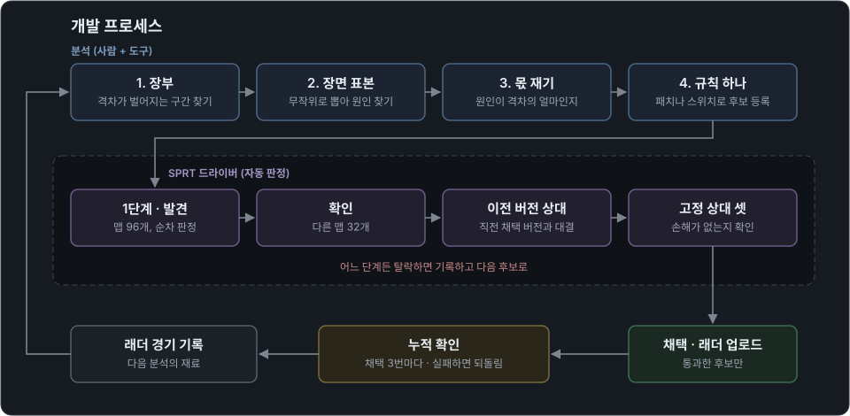

# Cambridge Battlecode 2026 가을 — 최종 봇과 SPRT 드라이버

한국어 | [English](README.en.md)

팀 SkuBap 의 최종 채택 버전 (v668) 과, 후보 규칙을 자동으로 판정 · 채택하던 도구입니다.
래더 최고 17위 (Master).

## 대회 소개

[Cambridge Battlecode](https://battlecode.co.uk) 는 케임브리지 대학에서 여는 대회입니다. 참가 팀은 게임을 하는 봇을 코드로 짜서 올리고, 봇끼리 래더에서 자동으로 맞붙어 Elo 점수로 순위를 가립니다. 사람이 경기 중에 조종하지 않습니다.

2026 가을 시즌 게임은 두 팀이 겨루는 팀 전략 게임입니다.

- **드래프트**: 경기 시작 때 두 팀이 번갈아 챔피언을 고릅니다 (맵에 따라 3~5명). 챔피언마다 능력치와 기술이 다릅니다.
- **농사**: 맵에 중립 몬스터 캠프가 무리 지어 있습니다. 무리를 잡고 점령하면 금과 젬을 받습니다.
- **성장**: 금으로 상점에서 아이템을 사서 챔피언을 키웁니다.
- **승리**: 모은 젬을 제단에 바치면 팀 점수가 됩니다. 먼저 1,000 젬을 바치거나, 2,000 라운드가 끝났을 때 젬이 많은 팀이 이깁니다.
- **교전**: 상대 챔피언을 잡으면 금을 얻고, 죽은 쪽은 들고 있던 젬을 잃고 한동안 빠집니다. 농사와 싸움 사이의 판단이 승부를 가릅니다.
- **연료**: 봇은 턴마다 쓸 수 있는 계산량 (연료) 이 정해져 있습니다. 넘기면 그 턴을 잃으므로, 좋은 판단을 싸게 계산하는 것도 실력입니다.

### 진행

| 시기 | 내용 |
|---|---|
| 10월 12일 | 게임 공개 |
| 10월 18일 · 25일 · 11월 1일 | 스프린트 1 · 2 · 3 (중간 점검 토너먼트) |
| 11월 4일 | 국제 예선 (상위 8팀 결선 진출) |
| 11월 16~18일 | 케임브리지 결선 |

대회 중에는 다른 팀 코드를 쓸 수 없고, 자기 코드도 대회가 끝날 때까지 비공개로 둡니다. 이 저장소는 대회가 끝난 뒤 공개했습니다.

### 우리 결과

- 팀 SkuBap, 봇 언어 C++.
- 한 달 동안 래더에 668개 버전을 올렸습니다.
- 래더 최고 17위, 마지막 기록 19위 (2,450 Elo, Master 등급).

## 개발 프로세스

래더 기록에서 격차가 나는 곳을 찾고, 원인을 확인해 규칙 하나를 만든 다음, 드라이버가 네 단계로 판정해 통과한 것만 채택했습니다.

## 구성

| 폴더 | 내용 |
|---|---|
| `bot/src/` | 최종 봇 소스 (C++). 래더에 올린 v668 과 코드가 같고, 주석의 다른 팀 이름만 지웠습니다. |
| `sprt_driver/sprt.py` | 롤 단위 짝 SPRT. 후보와 기준 봇을 같은 맵 · 두 자리에서 붙여 이득 여부를 순차 판정합니다. |
| `sprt_driver/drive3.py` | 드라이버. 대기열의 후보를 1단계 (발견) → 확인 → 이전 버전 상대 → 고정 상대 순으로 판정하고, 통과하면 채택합니다. |
| `sprt_driver/status3.py` | 현재 상태 한 장 보기. |
| `sprt_driver/patches/` | 후보 패치 본보기 3개. |

## 쓰는 법

- 저장소 뿌리를 환경 변수 `CAMBC_ROOT` 로 줍니다 (없으면 이 폴더의 위). 그 아래 `cambc_ws/bots`, `cambc_ws/maps_pool128`, `notes/ruler`, `submissions` 가 있어야 합니다.
- `cambc` 실행 파일 경로는 환경 변수 `CAMBC` 로 줍니다.
- 대기열 `notes/ruler/queue_user.txt` 한 줄 = `ID patch <패치 경로> gain` 또는 `ID flagoff <FLAG_ON> gain`.
- `python -X utf8 sprt_driver/drive3.py` 로 돌리고, `notes/ruler/STOP` 파일을 만들면 지금 후보까지만 끝내고 멈춥니다.

## 판정 설정

sigma 6 · mu1 6 · alpha 5% · beta 10% · 최대 16롤. 맵 128개를 발견용 96 · 확인용 32 로 나눕니다.
